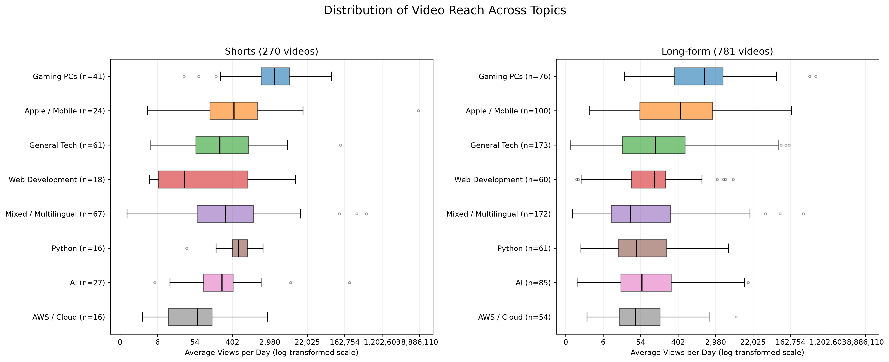
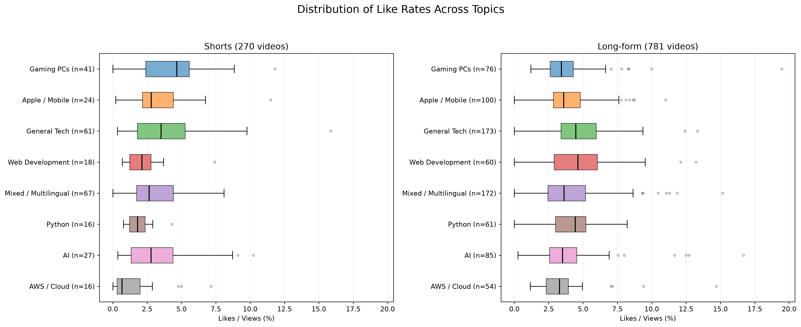
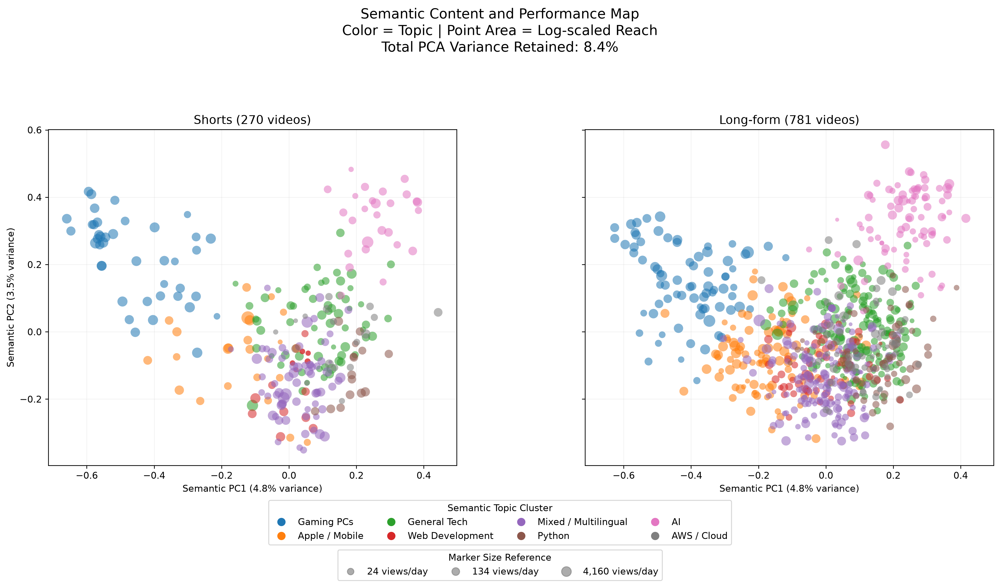

# CreatorLens: Continuous Performance and Semantic Analysis

## Objective

Extend the topic and performance cluster comparison
by preserving continuous video performance measurements.

Discrete performance clusters provide a useful overview,
but videos within the same cluster can have substantially
different reach and engagement levels.

This analysis complements the existing rank-based
visualizations rather than replacing them.

## Dataset

- Cohort: Technology creators
- Videos analyzed: 1,051
- Shorts: 270
- Long-form: 781
- Semantic topic clusters: 8

The analysis uses the combined video-level dataset
generated by compare_clusters.py.

## 1. Continuous Performance Metrics

### Average Views per Day

Views per day = Total views / Video age in days

This metric represents average accumulated views over
a video's lifetime.

A log1p transformation is used to visualize highly
skewed views-per-day values.

### Like Rate

Like rate = Total likes / Total views * 100

This measures likes relative to the number of views.

It does not include comments and should not be
interpreted as a complete engagement rate.

## 2. Continuous Performance Distributions

Box plots are used to compare video performance across
semantic topic clusters, separately for Shorts and
long-form videos.

Each box plot displays:

- Median
- First quartile (25th percentile)
- Third quartile (75th percentile)
- Whiskers based on the interquartile range
- Observations outside the whiskers

This allows performance differences and variability
to be examined without assigning individual videos
to discrete reach ranks.

### Views per Day Distribution

The views-per-day distribution uses a log-transformed
scale to reduce the visual influence of extreme values.

### Like Rate Distribution

## 3. Semantic Performance Map

### Sentence Embeddings

Each video title is represented by a normalized
384-dimensional sentence embedding generated using
all-MiniLM-L6-v2.

These embeddings capture semantic relationships
between video titles.

### Principal Component Analysis

PCA reduces the 384-dimensional embeddings to two
principal components for visualization.

A single PCA model is fitted across both video
formats so that their coordinates are comparable.

The resulting coordinates are:

- semantic_x: First semantic principal component
- semantic_y: Second semantic principal component

These components are mathematical combinations of
the original embedding dimensions.

They do not directly represent views, likes,
engagement, or individual topics.

PCA is used only for visualization in this analysis.
The original topic assignments were generated using
K-means on normalized 384-dimensional embeddings.

### Visual Interpretation

Each point represents one video.

- Position: Approximate semantic similarity
- Color: Semantic topic cluster
- Marker size: Log-scaled average views per day

Larger points indicate higher continuous reach.

Nearby points may represent semantically similar
video titles, although the two-dimensional projection
does not preserve all original relationships.

### Semantic Content and Performance Map

## 4. Dashboard Data Dictionary

### dashboard_video_performance.csv

Video-level data for interactive visualizations.

| Column | Description |
|---|---|
| video_id | YouTube video identifier |
| title | Video title |
| video_type | Shorts or Long-form |
| topic_cluster | Numerical semantic cluster ID |
| topic | Approximate topic label |
| performance_cluster | Numerical performance cluster ID |
| performance_rank | Reach rank from 1 to 4 |
| views | Total recorded views |
| likes | Total recorded likes |
| views_per_day | Average accumulated views per day |
| like_rate | Likes divided by views, expressed as a percentage |
| log_views_per_day | Log1p-transformed views per day |
| semantic_x | First semantic PCA coordinate |
| semantic_y | Second semantic PCA coordinate |
| marker_size | Scaled marker area for visualization |

### continuous_performance_summary.csv

Aggregated continuous performance statistics by
video format and topic.

| Column | Description |
|---|---|
| video_type | Shorts or Long-form |
| topic | Approximate semantic topic |
| video_count | Number of videos |
| median_views_per_day | Median average daily views |
| q1_views_per_day | 25th percentile of average daily views |
| q3_views_per_day | 75th percentile of average daily views |
| median_like_rate | Median like rate |
| q1_like_rate | 25th percentile of like rate |
| q3_like_rate | 75th percentile of like rate |

## 5. Visualization Team Recommendations

The existing data exports can support the following
interactive dashboard components:

- Topic and performance heatmaps
- Stacked percentage bar charts
- Continuous performance box plots
- Violin plots
- Interactive semantic scatterplots
- Topic and video format filters
- Individual video tooltips

Suggested datasets:

| Visualization | Recommended CSV |
|---|---|
| Heatmaps | dashboard_topic_performance.csv |
| Highest-reach comparisons | dashboard_highest_reach.csv |
| Box plots and violin plots | dashboard_video_performance.csv |
| Median and quartile comparisons | continuous_performance_summary.csv |
| Semantic scatterplots | dashboard_video_performance.csv |
| Individual video exploration | dashboard_video_performance.csv |

The visualization team does not need to retrain
the clustering models to use these exported results.

## 6. Limitations

- Two-dimensional PCA loses information from the
  original 384-dimensional embeddings.
- Semantic axes do not have fixed human-readable meanings.
- Topic labels are approximate.
- The embedding model is primarily designed for English.
- Some topic clusters contain multilingual or mixed content.
- Views per day does not measure current growth.
- Marker sizes represent transformed reach, not raw views.
- Like rate excludes comments.
- Creator-level differences may influence performance.
- Results are limited to the selected technology cohort.

## 7. Additional Cohorts

Additional creator cohorts can be analyzed using the
same general methodology.

Topic assignments, semantic coordinates, and performance
ranks should be reviewed when additional data is introduced
or the models are retrained.

Coordinates from independently fitted PCA models should
not be treated as directly comparable.

## Reproducing the Visualizations

Run from the repository root:

    python embedding_clustering.py
    python compare_clusters.py
    python comparison_visualization.py
    python continuous_visualization.py

Generated data and visualizations are stored in
modeling_outputs/.