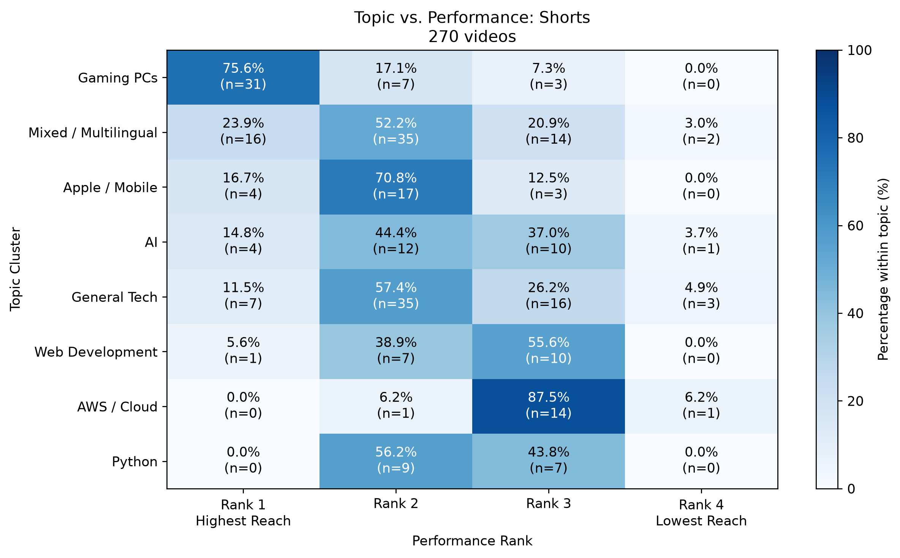
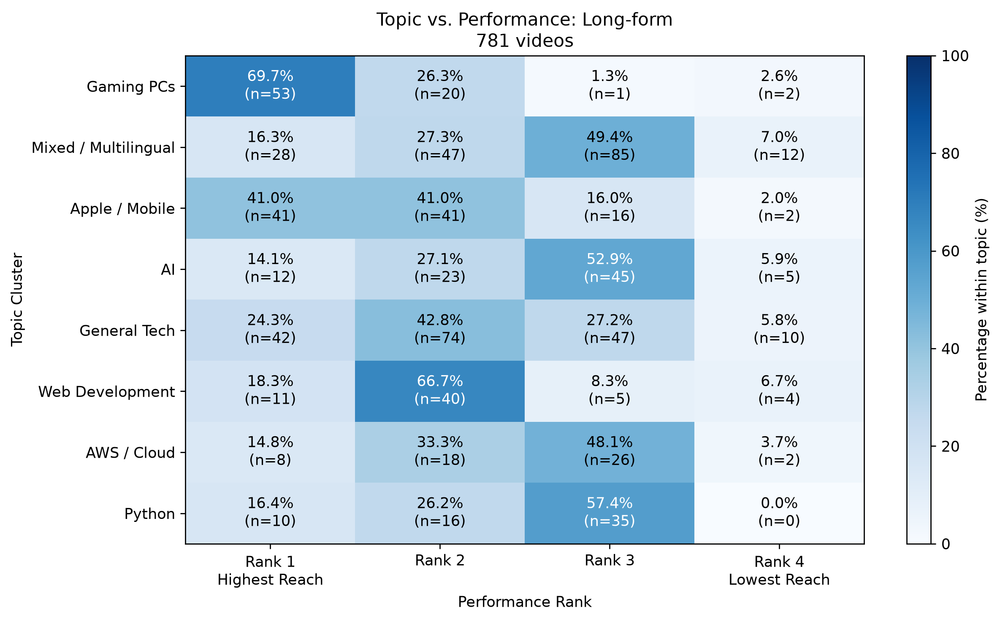
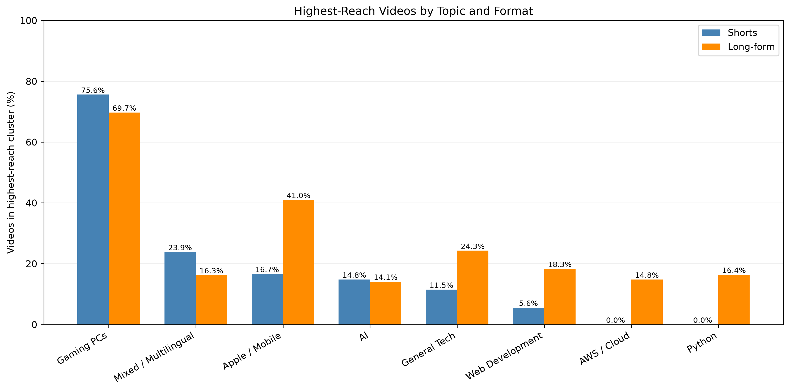

# CreatorLens: Topic and Performance Cluster Analysis

## Objective

Connect semantic topic clustering with numerical performance
clustering to explore the relationship between video content,
format, and performance.

## Dataset

- Cohort: Technology creators
- Original dataset: 1,300 videos from 130 channels
- Selected publication date range: 2024/11/22 to 2026/11/17
- Matched videos: 1,051
- Shorts: 270
- Long-form: 781

## Methodology

### Topic Clustering

Video titles are converted into 384-dimensional sentence
embeddings using the pretrained all-MiniLM-L6-v2 model.

K-means with k=8 is applied to the normalized embeddings
to identify groups of semantically similar video titles.

The resulting topic clusters are approximately labeled as:

- AI
- AWS / Cloud
- Apple / Mobile
- Gaming PCs
- General Tech
- Mixed / Multilingual
- Python
- Web Development

Topic labels are manually inferred from representative
titles within each cluster.

### Performance Clustering

Performance clustering uses six numerical features:

- Log-transformed views
- Log-transformed likes
- Log-transformed comments
- Like rate
- Comment rate
- Log-transformed views per day

The features are standardized and reduced to three
principal components using PCA.

K-means with k=4 is applied separately to Shorts and
long-form videos.

### Reach Calculation

Average views per day is calculated as:

Views per day = Total views / Video age in days

Video age is calculated using the difference between
the data collection date and publication date, with
a minimum age of one day.

Performance clusters are ordered by their median views
per day:

- Rank 1: Highest median views per day
- Rank 2: Second-highest median views per day
- Rank 3: Third-highest median views per day
- Rank 4: Lowest median views per day

Ranks are calculated independently for each video format.

Reach ranks do not necessarily represent overall
engagement quality.

### Combined Analysis

Each video receives two independent cluster assignments:

1. A semantic topic cluster.
2. A numerical performance cluster.

The assignments are matched at the video level.

Cross-tabulation is used to calculate the number and
percentage of videos belonging to each topic and
performance rank combination.

Percentage within topic = Videos in topic and rank /
Total videos in topic and format * 100

This analysis connects the results of two clustering
models rather than training a new combined K-means model.

## Results

### Shorts

| Topic | Rank 1 | Rank 2 | Rank 3 | Rank 4 |
|---|---:|---:|---:|---:|
| AI | 14.8% | 44.4% | 37.0% | 3.7% |
| AWS / Cloud | 0.0% | 6.2% | 87.5% | 6.2% |
| Apple / Mobile | 16.7% | 70.8% | 12.5% | 0.0% |
| Gaming PCs | 75.6% | 17.1% | 7.3% | 0.0% |
| General Tech | 11.5% | 57.4% | 26.2% | 4.9% |
| Mixed / Multilingual | 23.9% | 52.2% | 20.9% | 3.0% |
| Python | 0.0% | 56.2% | 43.8% | 0.0% |
| Web Development | 5.6% | 38.9% | 55.6% | 0.0% |

### Long-form

| Topic | Rank 1 | Rank 2 | Rank 3 | Rank 4 |
|---|---:|---:|---:|---:|
| AI | 14.1% | 27.1% | 52.9% | 5.9% |
| AWS / Cloud | 14.8% | 33.3% | 48.1% | 3.7% |
| Apple / Mobile | 41.0% | 41.0% | 16.0% | 2.0% |
| Gaming PCs | 69.7% | 26.3% | 1.3% | 2.6% |
| General Tech | 24.3% | 42.8% | 27.2% | 5.8% |
| Mixed / Multilingual | 16.3% | 27.3% | 49.4% | 7.0% |
| Python | 16.4% | 26.2% | 57.4% | 0.0% |
| Web Development | 18.3% | 66.7% | 8.3% | 6.7% |

Percentages are rounded and may not sum to exactly 100%.

## Key Findings

- Gaming PC content had the highest proportion of
  Rank 1 videos across both formats.
- 31 of 41 Gaming PC Shorts were assigned to Rank 1.
- 53 of 76 long-form Gaming PC videos were assigned
  to Rank 1.
- Apple/Mobile content had a higher proportion of
  Rank 1 videos in the long-form dataset.
- Python and AWS/Cloud videos were more frequently
  assigned to lower-reach clusters.
- Web development performance distributions differed
  between Shorts and long-form videos.

These findings describe associations within the
selected technology cohort.

## Visualizations

### Shorts Topic vs. Performance

### Long-form Topic vs. Performance

### Highest-Reach Comparison

## Output Files

All generated files are stored in modeling_outputs/.

- topic_vs_performance.csv
- shorts_cluster_counts.csv
- shorts_cluster_percentages.csv
- long_form_cluster_counts.csv
- long_form_cluster_percentages.csv
- dashboard_topic_performance.csv
- dashboard_highest_reach.csv

## Limitations

- Topic clusters have weak semantic separation.
- Topic labels are approximate.
- Creator audience size and video age may influence
  the observed performance differences.
- Views per day measures average accumulated reach,
  not current growth.
- Performance ranks are relative to each format.
- The comparison reconstructs the numerical clustering
  procedure, but exact video-level agreement with
  the original model has not been independently verified.
- Results are descriptive rather than causal.

## Reproducing the Analysis

Run the following scripts from the repository root:

    python embedding_clustering.py
    python compare_clusters.py
    python comparison_visualization.py